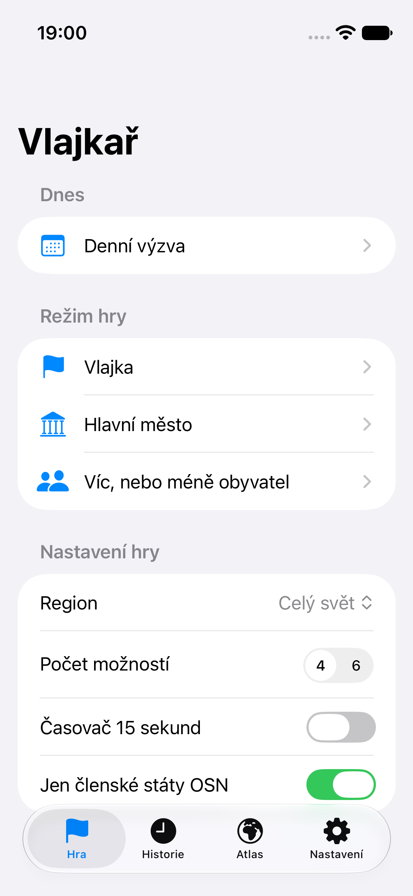
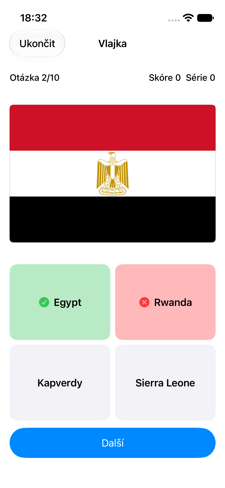
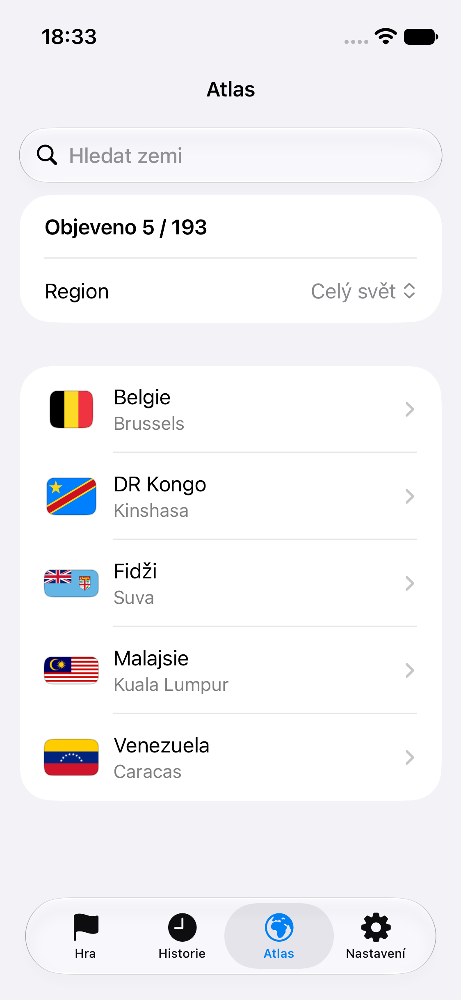
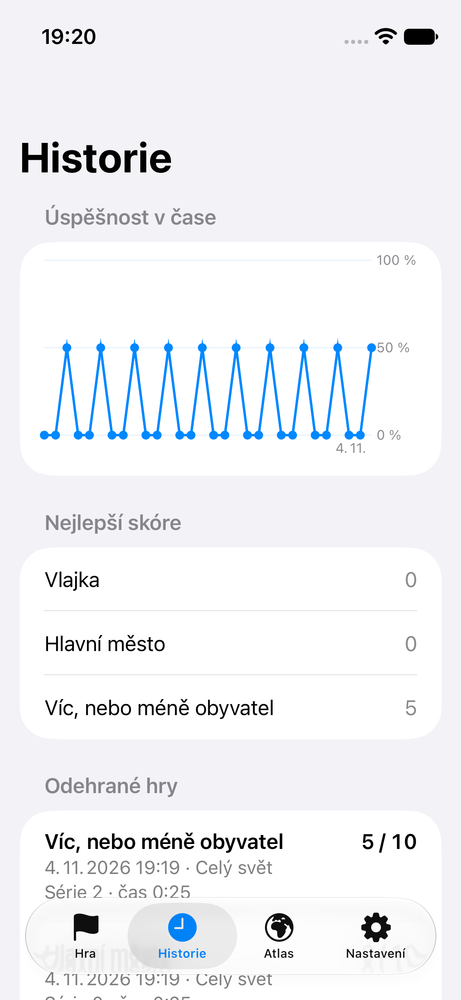

# Vlajkař

Zeměpisný kvíz pro iPhone 12 mini ve SwiftUI a SwiftData. Semestrální projekt AP9PT, FAI UTB. Aplikace jednou stáhne země z REST Countries v5 a pak se hraje úplně offline včetně vlajek.

| Domů | Hra | Atlas | Historie |
| --- | --- | --- | --- |
|  |  |  |  |

## Funkce
Režimy Vlajka, Hlavní město a Víc/méně obyvatel, nastavení hry, časovač, historie s rekordy a grafem, atlas s mapou, denní výzva, akce pro Zkratky.

## Požadavky
Xcode 27.2, iOS 17.0 nebo novější, klíč k REST Countries.

## Spuštění
1. Zkopírujte `Config/Secrets.example.plist` do `Vlajkar/Vlajkar/Secrets.plist` a vložte klíč. Bez klíče aplikace nabídne přibalená data bez vlajek.
2. Otevřete `Vlajkar/Vlajkar.xcodeproj` a spusťte schéma `Vlajkar`.

Testy spustíte přes `./test.sh all`, screenshoty přes `./screenshots.sh`.

## Spuštění na jiném Macu
Potřebujete Xcode 27 nebo novější, projekt používá nový formát `project.xcproj`.

1. Stáhněte repozitář z GitHubu a vložte `Vlajkar/Vlajkar/Secrets.plist` s klíčem, soubor v gitu není.
2. Se stejným Apple účtem: Xcode → Settings → Apple Accounts → + . Přihlášení platí jen pro Xcode a účet jde po práci zase odebrat. Team i Bundle ID zůstanou, aplikace se na iPhonu obnoví i s daty.
3. S jiným účtem: v Signing & Capabilities změňte Team a Bundle ID. Vznikne nová aplikace, data se stáhnou znovu.
4. Bez účtu: spusťte aplikaci v simulátoru iPhone 12 mini, podpis není potřeba.

## Dokumentace
[PRD](docs/PRD.md), [architektura](docs/ARCHITECTURE.md), [rozhodnutí](docs/DECISIONS.md), [ověření](docs/VERIFICATION.md), [průběh](docs/PROGRESS.md), [review](docs/AGENT-REVIEW.md), [prezentace](docs/PRESENTATION.md), [předávka](docs/HANDOFF.md).
