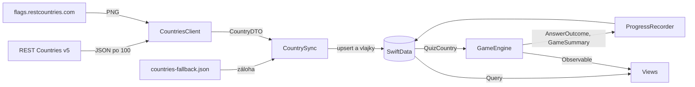
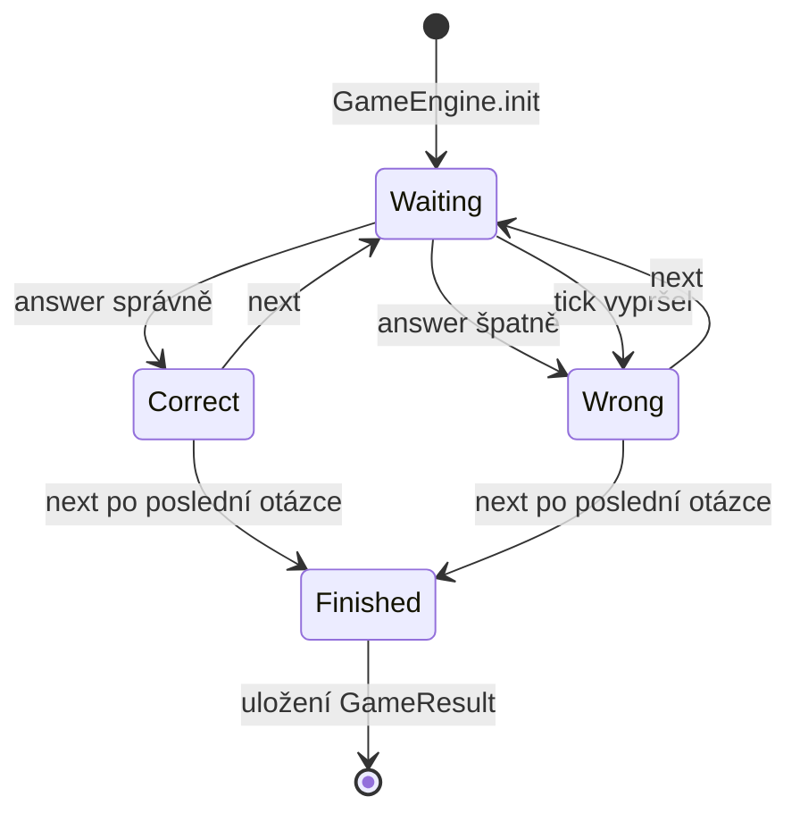

# Architektura

## Tok dat

## Vrstvy
| Vrstva | Složka | Odpovědnost |
| --- | --- | --- |
| Aplikace | `App/` | Vstupní bod, sdílené závislosti, přepínače pro testy |
| Modely | `Models/` | `Country`, `GameResult`, `GameMode`, `CountryDTO` |
| Síť | `Networking/` | REST Countries v5, přibalená záloha, testovací klienti |
| Persistence | `Persistence/` | Upsert, vlajky, zápis postupu, testovací data |
| Hra | `Game/` | `GameEngine`, otázky, filtr atlasu, statistiky, denní výzva, App Intent |
| UI | `Views/` | Zobrazení a posílání akcí, žádná herní logika |
| Pomůcky | `Utilities/` | Formátování, cache vlajek, načtení klíče |

Všechno sdílené jde přes `AppDependencies`, který vzniká jednou jako `@State` ve `VlajkarApp` a předává se přes `.environment`.

## Datový model
**`Country`:** `code` (`codes.alpha_3`, unikátní), `nameCS` a `officialNameCS` (`names.translations.ces`, záloha anglický název), `capital` (první položka `capitals`), `region`, `subregion`, `population`, `isUNMember` (`memberships.un`), `latitude`, `longitude` (`coordinates`), `flagURL` (`flag.url_png`), `flagPNG` (mimo hlavní databázi), `discoveredAt`, `correctCount`, `wrongCount` (postup hráče, synchronizace je nepřepisuje).

**`GameResult`:** `date`, `mode`, `region`, `score`, `total`, `bestStreak`, `duration`, `isDaily`.

**`CountryDTO`:** jen dekódování odpovědi API.

## Životní cyklus hry

## Mapa kódu pro obhajobu
| Otázka | Soubor:řádek |
| --- | --- |
| Kde žije herní stav? | `Vlajkar/Vlajkar/Game/GameEngine.swift:6` |
| Kde se vyhodnocuje odpověď? | `Vlajkar/Vlajkar/Game/GameEngine.swift:51` |
| Kde je časovač? | `Vlajkar/Vlajkar/Game/GameEngine.swift:69` |
| Kde se generují otázky? | `Vlajkar/Vlajkar/Game/QuestionGenerator.swift:17` |
| Kde se vybírají země pro režim? | `Vlajkar/Vlajkar/Game/QuestionGenerator.swift:6` |
| Kde se vytváří hra? | `Vlajkar/Vlajkar/App/AppDependencies.swift:28` |
| Kde se předává environment? | `Vlajkar/Vlajkar/App/VlajkarApp.swift:11` |
| Kde je `.modelContainer`? | `Vlajkar/Vlajkar/App/VlajkarApp.swift:13` |
| Kde se ukládá výsledek? | `Vlajkar/Vlajkar/Persistence/ProgressRecorder.swift:24` |
| Kde se zapisují objevené země? | `Vlajkar/Vlajkar/Persistence/ProgressRecorder.swift:7` |
| Kde je upsert? | `Vlajkar/Vlajkar/Persistence/CountrySync.swift:72` |
| Kde je limit 6 vlajek? | `Vlajkar/Vlajkar/Persistence/CountrySync.swift:30` a `Vlajkar/Vlajkar/Persistence/CountrySync.swift:121` |
| Kde je stránkování API? | `Vlajkar/Vlajkar/Networking/CountriesClient.swift:51` |
| Kde je hlavička s klíčem? | `Vlajkar/Vlajkar/Networking/CountriesClient.swift:72` |
| Kde se ukazuje chyba sítě? | `Vlajkar/Vlajkar/Views/Home/SetupView.swift:43` a `Vlajkar/Vlajkar/Views/Settings/SettingsView.swift:46` |
| Kde jsou texty chyb? | `Vlajkar/Vlajkar/Networking/CountriesClient.swift:9` |
| Kde je filtrování atlasu? | `Vlajkar/Vlajkar/Game/AtlasFilter.swift:9` a `Vlajkar/Vlajkar/Views/Atlas/AtlasView.swift:14` |
| Kde je `@Query` atlasu? | `Vlajkar/Vlajkar/Views/Atlas/AtlasView.swift:6` |
| Kde se maže historie? | `Vlajkar/Vlajkar/Views/History/HistoryView.swift:45` |
| Kde se pamatuje nastavení? | `Vlajkar/Vlajkar/Views/Home/HomeView.swift:7` |
| Kde je popisek VoiceOver? | `Vlajkar/Vlajkar/Views/Game/GameView.swift:166` |
| Kde se dekódují vlajky? | `Vlajkar/Vlajkar/Utilities/FlagImageCache.swift:27` |
| Kde jsou přepínače testů? | `Vlajkar/Vlajkar/App/LaunchOptions.swift:15` |
| Kde je semínko denní výzvy? | `Vlajkar/Vlajkar/Game/DailyChallenge.swift:8` |
| Kde jsou data grafu? | `Vlajkar/Vlajkar/Game/HistoryStats.swift:6` |
| Kde je App Intent? | `Vlajkar/Vlajkar/Game/PlayDailyChallengeIntent.swift:21` |
